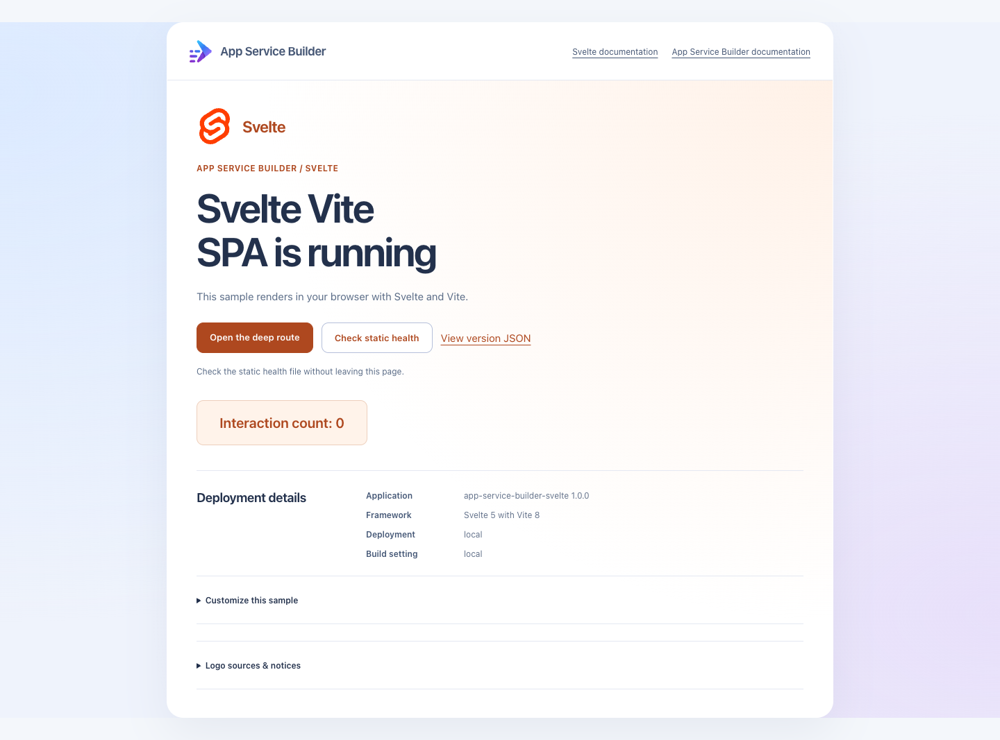

# App Service Builder: Svelte sample

A standalone Svelte single-page application built with Vite for
[Azure App Service Builder](https://builder.appservice.azure.com/docs/). It uses
Svelte 5 runes and the browser History API, without SvelteKit or a routing
library. The deployment consists only of static HTML, JavaScript, CSS, and
JSON. There is no backend, database, external service, or hosted Vite
development server.

**App Service Builder is in Private Preview. Use this sample for development
and testing, not as a production application template.** The original sample
was successfully deployed with the included manifest and its tested links
worked. The renamed repository must still be deployed and verified in your
authorized preview environment. Local checks do not establish cloud deployment
success or regional availability.

## Sample preview



Rendered locally at `/` from the production build with sample settings. This
screenshot is not evidence of an Azure deployment.

**Check static health** reads `/health.json` and displays the result in place,
including failures and retry guidance. A reachable static file is not a backend
health probe or Azure deployment status. **Customize this sample** explains which
files to edit in your fork; it does not guess your repository or app URL.
Framework and App Service Builder documentation are labeled separately.

## Features

- Svelte landing page with an interactive counter.
- Client-side navigation, browser back/forward handling, and a nested product page.
- A client-side not-found page and trailing-slash normalization.
- Static health and application identity JSON files.
- Hashed JavaScript and CSS assets built into `dist/`.
- A minimal `builder.yaml` that relies on Vite detection.
- Dependency-free Node.js tests for build output and the local static HTTP contract.

## Prerequisites

- [Node.js 24 LTS](https://nodejs.org/) and its bundled npm are recommended.
- [Git](https://git-scm.com/) and a GitHub account.
- For deployment: App Service Builder Private Preview access, an authorized
  Azure subscription, and an existing resource group in a supported preview
  location.
- Optional: [PowerShell 7](https://learn.microsoft.com/powershell/scripting/install/installing-powershell)
  for the endpoint verification script.

The lockfile contains Svelte **5.57.3**, Vite **8.3.5**, the Svelte Vite plugin
**7.3.1**, and svelte-check **4.7.8**. Keep `package-lock.json` and use `npm ci`
to install the locked versions rather than updating dependencies during setup.

## Run locally

Fork
[AzureAppService/app-service-builder-svelte](https://github.com/AzureAppService/app-service-builder-svelte/fork)
to your GitHub account. Clone your fork, replacing `<your-github-account>`:

```sh
git clone https://github.com/<your-github-account>/app-service-builder-svelte.git
cd app-service-builder-svelte
npm ci --ignore-scripts
npm run dev -- --host 127.0.0.1 --port 5173 --strictPort
```

Open `http://localhost:5173/`. Expect the heading `Svelte Vite SPA is running`.
Click **Interaction count: 0** and confirm it increments. Follow **Open the
deep route** to see `Widget 1`, then use **Return home** or browser navigation.

The development server is local only and is not the deployed runtime. Stop
it with Ctrl+C. The explicit `--strictPort` fails if the requested port is
already in use instead of silently choosing another port.

## Check, build, test, and preview

From the repository root:

```sh
npm run check
npm run build
npm test
npm run preview -- --host 127.0.0.1 --port 8080 --strictPort
```

Open `http://localhost:8080/` to view the production bundle. The local Vite
preview is a development check of `dist/`, not a production server to deploy.
Stop it with Ctrl+C.

`npm run check` checks Svelte and JavaScript types using the existing
`jsconfig.json`. Tests check the manifest, static output, health/version JSON,
generated JavaScript and CSS, and local SPA-shell fallback. They start their
own loopback-only preview on an available port and stop it when finished.
Build before running `npm test`. GitHub Actions runs check, build, and tests
on Linux and Windows with Node.js 24.

With the preview running, optionally check the local or deployed URL using
PowerShell 7:

```powershell
pwsh -NoProfile -File .\scripts\verify.ps1 -BaseUrl http://localhost:8080
```

The script checks HTTP responses and the HTML shell; it does not execute
Svelte. In a browser, also verify the counter, in-app navigation, back/forward,
direct navigation to `/products/widget-1`, refreshing that route, and the
unknown route's `Page not found` heading.

## Routes and SPA fallback

| Route | Expected behavior |
|---|---|
| `/` | HTTP 200 shell; Svelte renders the landing page and counter |
| `/products/widget-1` | HTTP 200 shell; Svelte renders `Widget 1` |
| `/products/widget-1/` | Same client-side product page after trailing-slash normalization |
| `/unknown-client-route` | HTTP 200 shell; Svelte renders `Page not found` |
| `/health.json` | HTTP 200, static JSON with `"status": "ok"` |
| `/version.json` | HTTP 200, static application and framework metadata |
| `/assets/` files | Generated JavaScript and CSS loaded by the HTML shell |

This app uses the browser History API, not hash-based routing. Direct nested
links and refreshes require the deployed static host to return `index.html`
for client-side routes. The manifest does not declare a separate fallback
override. Verify this behavior after deployment; a successful root response
alone is insufficient.

The unknown client route intentionally has HTTP status 200 when the host
returns the shell. Its not-found heading is rendered in the browser, not
returned as a server-side HTTP 404. The health file is a static asset, not a
running backend health probe.

## Deployment contract

The repository root contains `builder.yaml`:

```yaml
components:
  - name: site
    path: /
```

This intentionally relies on Vite detection to infer the Node.js build
platform, `npm run build`, the `dist` output directory, and the static role.
The source directory defaults to the repository root. The current test set
already established the manifest requirement before this sample was deployed.

Node.js is the build toolchain, not a deployed application server. Builder
must publish the built `dist/` output, not the source directory or
`node_modules/`. No custom build command, runtime port, or start command is
needed. Do not select `src/`, `public/`, or `dist/` as the repository source
directory.

## Deploy your fork through Builder Portal

Follow the [Portal quickstart](https://builder.appservice.azure.com/docs/quickstarts/portal/)
for your authorized Private Preview environment:

1. Commit and push the sample to the `main` branch of your GitHub repository.
   Builder uses committed GitHub source, not local files.
2. Open Builder Portal and select your enabled subscription, existing resource
   group, and supported preview location.
3. Connect GitHub and authorize the Builder GitHub app to access your repository.
   Obtain organization-owner approval if required.
4. Create an app using your repository, branch `main`, and the repository root
   as its source directory. Keep `builder.yaml` at that root.
5. Explicitly start deployment and wait for a successful terminal status.
   Connecting a source or pushing a commit is not proof of deployment.
6. Open the returned runtime URL and verify the landing page, counter, generated
   assets, `/health.json`, and `/version.json`.
7. Open `/products/widget-1` directly and refresh it. Open an unknown client
   route and confirm Svelte renders `Page not found`.

### Public build-time markers

`VITE_DEPLOYMENT_MARKER` and `VITE_BUILD_MARKER` are optional labels displayed
under deployment details. Both default to `local` and are embedded in the
public JavaScript bundle at build time. They do not change the static health
or version JSON files.

For a local PowerShell build:

```powershell
$env:VITE_DEPLOYMENT_MARKER = "demo-1"
$env:VITE_BUILD_MARKER = "hello-svelte"
npm run build
npm run preview -- --host 127.0.0.1 --port 8080 --strictPort
```

**Never put credentials, connection strings, or private information in
`VITE_*` variables.** Changing an environment variable after the build does
not update existing assets.

For a deployed app, configure the labels in Portal **Variables**, then deploy
to rebuild the static output. Saving variables alone does not establish that
the current bundle changed. See the
[variables guide](https://builder.appservice.azure.com/docs/guides/variables/).

### Update and redeploy

Edit the application, run check/build/tests, commit, and push to your fork's
`main` branch. Explicitly deploy through Builder Portal, wait for completion,
and verify the public pages and deep links again. Automatic deployment on push
is not qualified by this sample.

### Cleanup

Delete only the Builder app you created and wait for deletion to complete.
Do not delete a shared resource group, subscription, or unrelated resources.
Deleting the app does not delete your GitHub repository or local clone.

## Resources and contributions

- [App Service Builder documentation](https://builder.appservice.azure.com/docs/)
- [Sample catalog](https://builder.appservice.azure.com/docs/samples/)
- [Manifest guide](https://builder.appservice.azure.com/docs/guides/builder-yaml/)
- [Contributing](CONTRIBUTING.md)
- [Code of Conduct](.github/CODE_OF_CONDUCT.md)
- [Security reporting](SECURITY.md)
- [Changelog](CHANGELOG.md)
- [MIT license](LICENSE.md)
